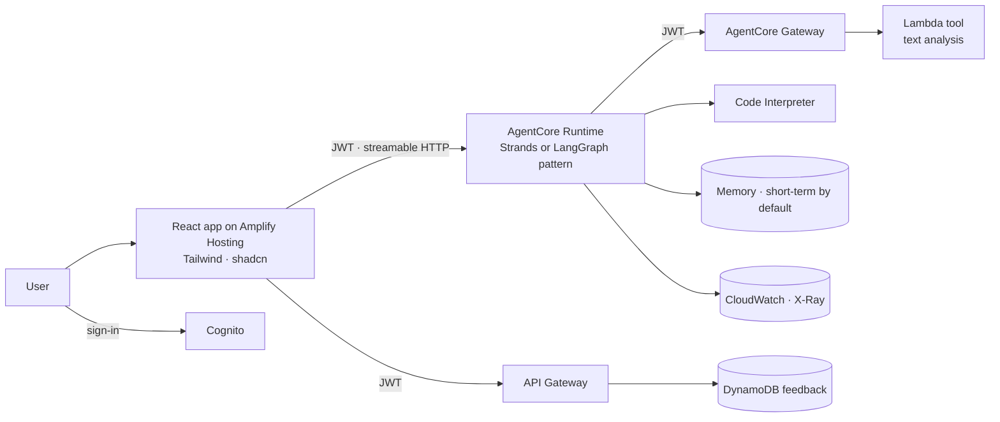

# Lab 43 · Field pattern: full-stack agent app from the FAST starter, customized with Kiro

> **Outcome:** A deployed, authenticated chat app backed by an AgentCore agent with a Gateway tool and Code Interpreter. You then extend it with Kiro: a new Gateway tool, long-term memory, and a different agent pattern.

> **From the field:** [Accelerate agentic application development with a full-stack starter template for Amazon Bedrock AgentCore](https://aws.amazon.com/blogs/machine-learning/accelerate-agentic-application-development-with-a-full-stack-starter-template-for-amazon-bedrock-agentcore/) (AWS ML Blog, Feb 2026; repo: [awslabs/fullstack-solution-template-for-agentcore](https://github.com/awslabs/fullstack-solution-template-for-agentcore)). FAST is **designed for AI-assisted development**. It ships steering documents, feature guides and READMEs throughout, so coding agents like Kiro follow its patterns.

## Architecture



Cognito secures four integration points: frontend sign-in, frontend → Runtime, agent → Gateway, and frontend → API Gateway.

## Step 1 — Deploy

Prereqs: Node 20+, Python 3.11+, Docker, the AWS CLI and the CDK.

```bash
git clone https://github.com/awslabs/fullstack-solution-template-for-agentcore.git
cd fullstack-solution-template-for-agentcore
# edit infra-cdk/config.yaml: stack_name_base, admin_user_email, backend.pattern (strands-single-agent | langgraph-single-agent), deployment_type (docker | zip)
cd infra-cdk && npm install && cdk bootstrap && cdk deploy      # ~5–10 min
cd .. && python scripts/deploy-frontend.py                        # prints the Amplify app URL
```

Sign in, then try *"Analyze the text: The quick brown fox jumps over the lazy dog"* (Gateway tool) and *"Calculate the first 20 Fibonacci numbers"* (Code Interpreter).

## Step 2 — Open it in Kiro and let the steering lead

Open the repo as a Kiro workspace and generate any missing foundation steering. FAST already ships steering docs and feature guides, so ask Kiro to summarize the conventions before it changes anything:

```text
> Read the steering docs and feature guides. Summarise the rules for adding a Gateway
  tool, changing the agent pattern, and enabling long-term memory.
```

## Step 3 — Extend with specs

```text
> Create a spec "order-lookup-tool": a Lambda behind AgentCore Gateway that returns order
  status by id (reuse labs/27 handler logic), schema defined in the CDK stack, unit tests,
  and a frontend hint chip. Follow FAST's documented pattern for Gateway tools.
> Enable long-term memory (user preferences strategy) following the memory feature guide.
```

Use the `iac-author` agent (Lab 05) for the CDK changes, and run `cdk diff` before a human deploys.

## Step 4 — Swap major components

- **Agent framework:** set `backend.pattern: langgraph-single-agent`, or add your own folder under `patterns/` with a `requirements.txt` and `Dockerfile`.
- **Frontend:** treat the React app as a reference integration. Keep the backend and plug in your own UI.
- **Identity:** point Cognito federation at your corporate IdP (Lab 29).

## Clean up

Run `cdk destroy` in `infra-cdk/`. Delete the Amplify app if the script created it outside the stack.

## Learn more

- [AgentCore Runtime](https://docs.aws.amazon.com/bedrock-agentcore/latest/devguide/agents-tools-runtime.html) · [Gateway](https://docs.aws.amazon.com/bedrock-agentcore/latest/devguide/gateway.html) · [Lab 34 — production composition](../34-e2e-agentic-customer-support/README.md)
