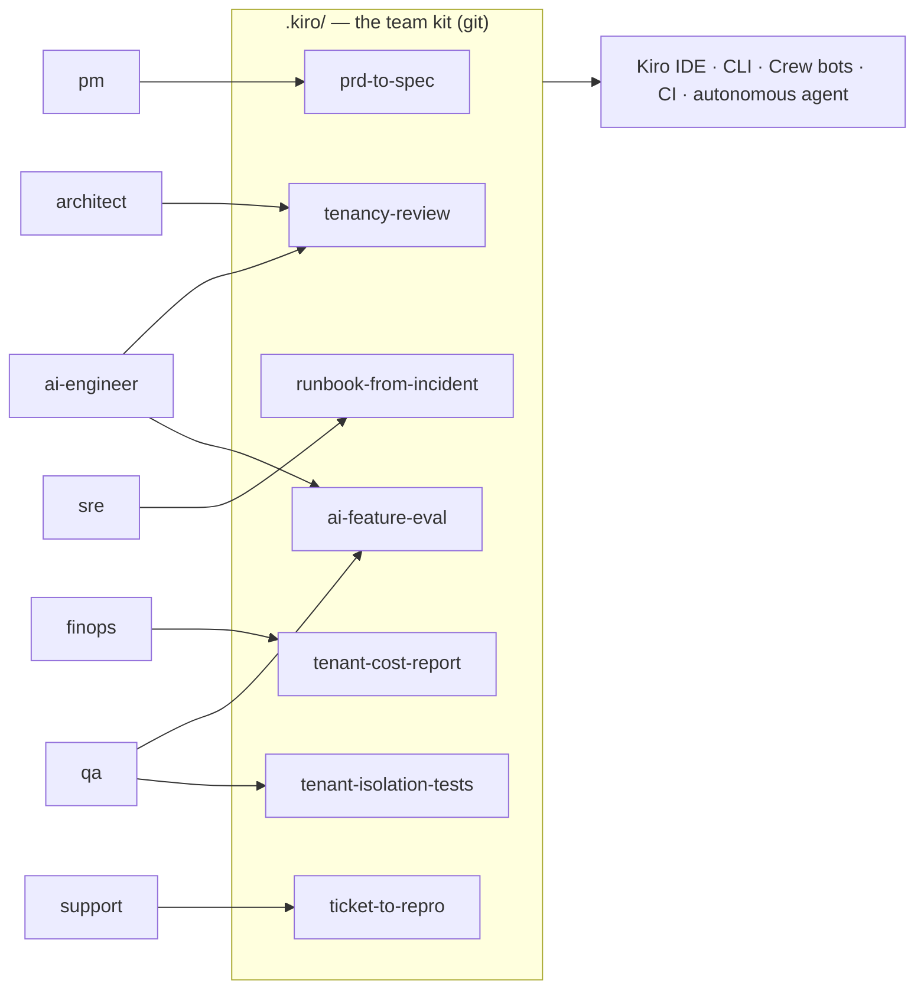

# Lab 45 · The AI-first team kit — a Kiro agent and skills for every persona

> **Outcome:** Seven persona agents (`pm`, `architect`, `qa`, `sre`, `finops`, `support`, `ai-engineer`) and seven tenant-aware skills, versioned in one repo. Every role on the team gets an assistant that knows its job, its limits and the fact that you run a **multi-tenant** product.

## Scenario

An AI-first organization isn't one engineer with a chatbot. **Every persona** delegates its repeatable work to agents, and the knowledge behind that work is shared, reviewed and versioned. Multi-tenancy is the cross-cutting concern that generic assistants miss: tenant context, isolation, tiers, metering and per-tenant cost.



## The kit

| Persona | Agent | Skills | What it automates | Hard limits |
| --- | --- | --- | --- | --- |
| Product manager | [`pm`](.kiro/agents/pm.json) | [`prd-to-spec`](.kiro/skills/prd-to-spec/SKILL.md) | Requests → EARS specs with tier, isolation and metering requirements, success metrics, rollout | Writes only under `.kiro/specs/` |
| Architect | [`architect`](.kiro/agents/architect.json) | [`tenancy-review`](.kiro/skills/tenancy-review/SKILL.md) | Reviews tenant context, isolation (including AI paths), noisy neighbours, tiering, lifecycle and residency | Synth/diff only |
| QA | [`qa`](.kiro/agents/qa.json) | [`tenant-isolation-tests`](.kiro/skills/tenant-isolation-tests/SKILL.md), [`ai-feature-eval`](.kiro/skills/ai-feature-eval/SKILL.md) | Cross-tenant negative test matrix covering APIs, caches, exports, RAG, memory and agent tools | Edits tests only |
| SRE | [`sre`](.kiro/agents/sre.json) | [`runbook-from-incident`](.kiro/skills/runbook-from-incident/SKILL.md) | Incident → runbook, alarm-as-code, regression test, backlog | Read-only AWS calls |
| FinOps | [`finops`](.kiro/agents/finops.json) | [`tenant-cost-report`](.kiro/skills/tenant-cost-report/SKILL.md) | Per-tenant AI and infra cost, margins, pricing actions | Read-only |
| Support | [`support`](.kiro/agents/support.json) | [`ticket-to-repro`](.kiro/skills/ticket-to-repro/SKILL.md) | Ticket → redacted, reproducible bug with tenant-scoped evidence; reply draft | Writes only under `docs/bugs/` |
| AI engineer | [`ai-engineer`](.kiro/agents/ai-engineer.json) | `ai-feature-eval`, `tenancy-review` | Eval gate for prompts, agents, RAG and model changes, with per-tier budgets | No deploys |

Every agent denies `*deploy*`, `*delete*`, `*destroy*` and `*terminate*`, and asks before any other shell command. AWS access goes through the AWS MCP Server and Agent Toolkit for AWS (Lab 15), so **IAM is the real boundary**. Give each persona a matching read-only role.

All seven skills pass strict Agent Skills validation (`AgentSkills(strict=True)`). The same folders therefore work in Strands agents, the AgentCore harness, Amazon Quick and other skill-aware tools.

## Step 1 — Install into your product repo

```bash
cp -r labs/45-ai-first-persona-kit/.kiro/{skills,agents} <your-saas-repo>/.kiro/
```

Add org-wide steering for your tenancy model, based on Lab 33's [`saas-architecture.md`](../33-e2e-serverless-saas/.kiro/steering/saas-architecture.md).

## Step 2 — A day in the AI-first team

```bash
kiro-cli --agent pm
> Turn this customer request into a spec: "Enterprise tenants want SSO-enforced exports of audit logs."

kiro-cli --agent architect
> /tenancy-review .kiro/specs/audit-log-exports/

kiro-cli --agent qa
> Generate the isolation test matrix for the audit-log export endpoints and run it against dev.

kiro-cli --agent finops
> What does tenant t-0042 cost us per month, including Bedrock, and what is its margin?

kiro-cli --agent support
> Ticket #8812: "exports are empty since Tuesday" — tenant t-0042. Reproduce.
```

## Step 3 — Put the kit to work without a human in the chair

| Where | How |
| --- | --- |
| CI (Lab 10) | `kiro-cli chat --no-interactive --agent architect "/tenancy-review <diff>"` on PRs that touch `infra/` or data access |
| Kiro Crew bots (Lab 13) | Support intake bot = `support` agent; cost sentinel = `finops` agent; build health = `sre` agent |
| Autonomous agent (Lab 14) | Issues labelled `kiro` inherit the steering and skills from the repo |
| Amazon Quick / Strands / AgentCore | Load the same `skills/` folders, so business users and production agents follow the same procedures |

## Step 4 — Govern the kit like code

- Use CODEOWNERS per skill: PM owns `prd-to-spec`, security owns `tenancy-review`.
- Changes to skills go through a PR with an eval (Lab 41's A/B harness).
- Track agent outcomes per persona: accepted suggestions, time saved, escaped defects.

## Learn more

- [AI-first SaaS playbook](../../docs/ai-first-saas-playbook.md) · [Lab 41 — skills at scale](../41-domain-skills-at-scale/README.md) · [Agent Toolkit for AWS](https://aws.amazon.com/products/developer-tools/agent-toolkit-for-aws/)
