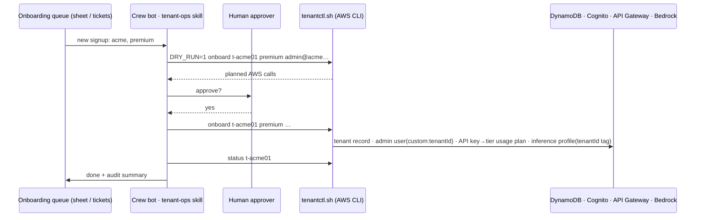

# Lab 46 · Automate the tenant lifecycle with Kiro, skills and the AWS CLI

> **Outcome:** Tenant operations that used to be tickets and console clicks now run as `tenantctl.sh onboard|suspend|resume|offboard|status`. A Kiro skill drives them through dry run → approval → execute → verify, a hook makes offboarding impossible without a ticket and confirmation, and a Crew bot works the onboarding queue.

## Scenario

Every new customer touches five systems: the tenant record, identity, API limits, AI cost attribution and the plan. Doing that by hand is slow and error-prone. Doing it by an *unconstrained* agent is dangerous. The AI-first answer is a **deterministic, idempotent script** that agents drive under **skills, hooks and approvals**.



## What onboarding creates, and why

| Step | AWS call | Why it matters for multi-tenancy |
| --- | --- | --- |
| Tenant record | `dynamodb put-item` (conditional) | Source of truth for tier and status; idempotent |
| Admin user | `cognito-idp admin-create-user` with `custom:tenantId` | The isolation key every downstream service trusts |
| API key in the tier's usage plan | `apigateway create-api-key` + `create-usage-plan-key` | Per-tier rate limits and quotas stop noisy neighbours |
| AI cost attribution | `bedrock create-inference-profile` (copy from the base model, tagged `tenantId`, `tier`) | Per-tenant Bedrock spend in Cost Explorer (Lab 48) |

Suspend and resume flip the status and enable or disable the tenant's API keys. **Offboarding** works in this order:

1. Export the tenant's data to S3 with KMS encryption.
2. Suspend the tenant.
3. Mark it `OFFBOARDED`.

Deletion follows the contractual retention window.

All 17 AWS CLI calls in [`tenantctl.sh`](scripts/tenantctl.sh) were checked against the AWS CLI's own parameter validation (botocore 1.43) without calling AWS.

## Step 1 — Dry run

```bash
cd labs/46-tenant-lifecycle-automation
export TENANTS_TABLE=tenants DATA_TABLE=data USER_POOL_ID=<pool> EXPORT_BUCKET=<bucket> \
       USAGE_PLAN_BASIC=<id> USAGE_PLAN_PREMIUM=<id> USAGE_PLAN_ENTERPRISE=<id> \
       BASE_MODEL_ARN=arn:aws:bedrock:us-east-1::foundation-model/amazon.nova-lite-v1:0
DRY_RUN=1 scripts/tenantctl.sh onboard t-acme01 premium admin@acme.example
```

These resources match Lab 33's SaaS backend. Use that stack, or create equivalents.

## Step 2 — Drive it with Kiro

Copy [`.kiro/skills/tenant-ops`](.kiro/skills/tenant-ops/SKILL.md), [`.kiro/hooks/tenant-guard.json`](.kiro/hooks/tenant-guard.json) and [`scripts/`](scripts/tenant_guard.py) into the SaaS repo, then:

```text
> Onboard Acme Corp (t-acme01) on premium, admin admin@acme.example, ticket SALES-311.
> Suspend t-acme01 for non-payment, ticket FIN-88.
> Offboard t-acme01, ticket CS-1203.        ← blocked until you give CONFIRM=t-acme01
```

## Step 3 — Hand the queue to a bot

Create a Kiro Crew bot (Lab 13) with this charter:

> Every 15 minutes, read new rows in the "Signups" sheet (Smartsheet MCP, Lab 42) with status Approved. For each one, apply the tenant-ops skill: dry run, then onboard. Post the summary on the row. Never suspend or offboard. Stop and ask if a tenant id already exists with a different tier.

## Step 4 — Extend

- **Tier change:** add an `upgrade` subcommand that moves the API key to another usage plan and updates the record. Kiro can write it with tests against the dry-run output.
- **Silo tier:** for `enterprise`, call a CDK pipeline that deploys a dedicated stack (Lab 33) instead of pooled resources.
- **Residency:** add a `region` argument and pin the tenant's resources to it.

## Verify

- [ ] Re-running `onboard` is safe: the conditional put prevents overwriting
- [ ] `offboard` without `CONFIRM` is refused by both the script and the hook
- [ ] A new tenant's Bedrock usage appears under its `tenantId` tag in Cost Explorer (after tag activation)

## Learn more

- [Per-tenant Bedrock costs with application inference profiles](https://aws.amazon.com/blogs/machine-learning/manage-multi-tenant-amazon-bedrock-costs-using-application-inference-profiles/) · [SaaS tenant isolation](https://docs.aws.amazon.com/whitepapers/latest/saas-architecture-fundamentals/tenant-isolation.html)
