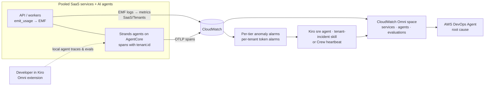

# Lab 47 · Tenant-aware observability with CloudWatch Omni

> **Outcome:** Your pooled SaaS emits per-tenant usage metrics (EMF) and `tenant.id`-tagged traces. CloudWatch Omni shows services, agents and tenants in one space. Per-tier anomaly alarms catch problems, and a Kiro `tenant-incident` skill plus AWS DevOps Agent explain them.

## What's new: CloudWatch Omni

**Amazon CloudWatch Omni** went GA in Sept 2026. AWS calls it *"an AI-powered observability experience organized around your teams and the applications they run."* What it offers:

| Capability | What it gives a SaaS team |
| --- | --- |
| **Spaces** across accounts, Regions and other clouds (Azure since Nov 2026) | One view of pooled and siloed tenants, wherever they run |
| Automatic service discovery, dependency maps, golden metrics | Topology without hand-built dashboards |
| Ask in chat, click through a guided path, or query with SQL; access from tools via **Agent Toolkit for AWS** | Kiro agents can query telemetry too |
| **Root cause powered by AWS DevOps Agent** | Correlates agents, apps and infrastructure |
| **Agent observability with evaluation-driven development** (Strands, LangGraph, CrewAI, OpenAI Agents SDK, Vercel AI SDK) | Every prompt, model call and tool call is traced and scored; you can run experiments before shipping a fix |
| Free **Omni extension for Kiro**, VS Code and Cursor | Instrument, debug and evaluate agents locally. No AWS account needed |
| OpenTelemetry (OTLP) ingestion; existing CloudWatch data, alarms and dashboards carry forward | Opt in without re-instrumenting |

Omni is opt-in: you create a space from the CloudWatch console. It launched in us-east-1, us-west-2 and eu-west-1, and has since expanded to more Regions. Ingestion bills grow with tracing volume, so sample wisely.

## Architecture



## Step 1 — Emit tenant telemetry

[`app/tenant_telemetry.py`](app/tenant_telemetry.py) produces EMF records in the `SaaS/Tenants` namespace. The dimension sets are `[TenantId]`, `[Tier]` and `[Tier, Feature]`, and the allowed metrics are Requests, AITokens, StorageGB and LatencyMs. It also produces OTel span attributes (`tenant.id`, `tenant.tier`, `tenant.region`).

```python
from tenant_telemetry import emit_usage, tenant_span_attributes
emit_usage(tenant_id, tier, "export", {"Requests": 1, "AITokens": usage.total_tokens, "LatencyMs": ms})
agent = Agent(..., trace_attributes=tenant_span_attributes(tenant_id, tier))   # Strands
```

```bash
cd labs/47-tenant-observability-cloudwatch-omni/app && pytest -q    # 4 passed
```

> **Cardinality.** `TenantId` is a high-cardinality dimension. Keep it on a few billable or alarmable metrics only, and slice everything else in Logs Insights or Omni.

## Step 2 — Create an Omni space

In the CloudWatch console, create an Omni space in your central monitoring account, attach the workload accounts and Regions, and configure SSO. Then ask Omni:

```text
Which tenants had the highest p95 latency in the last 24 hours, and which services were involved?
Show agent runs for tenant t-acme01 that failed a tool call today.
```

## Step 3 — Debug agents locally in Kiro

Install the **CloudWatch Omni extension** in Kiro from the extensions marketplace. Run your Strands agent locally to see its trace (model calls, tool calls, timings) and evaluation scores before you push. Pair it with the eval gate from the `ai-feature-eval` skill (Lab 45).

## Step 4 — Alarms that understand tiers

```bash
TOPIC_ARN=<sns-arn> TOP_TENANTS="t-acme01 t-globex2" ops/alarms.sh
```

[`ops/alarms.sh`](ops/alarms.sh) creates two kinds of alarm:

- per-tier **anomaly-detection** alarms on p95 latency, which catch the "premium got slow" class of problem;
- hard **per-tenant AI-token** alarms for your largest tenants, which catch runaway agents and abuse.

All 7 AWS CLI calls pass the CLI's parameter validation.

## Step 5 — Investigate like an AI-first SRE team

Copy [`.kiro/skills/tenant-incident`](.kiro/skills/tenant-incident/SKILL.md) and the queries in [`ops/tenant_queries.md`](ops/tenant_queries.md), then:

```bash
kiro-cli --agent sre      # from Lab 45
> Alarm latency-anomaly-premium fired at 02:10. Investigate with the tenant-incident skill.
```

The skill runs four checks: scope (one tenant, one tier or everyone), a noisy-neighbour check, traces filtered by `tenant.id`, and recent changes. It escalates to an **AWS DevOps Agent** investigation in Omni when the cause isn't obvious within 15 minutes, then hands off to `runbook-from-incident`.

To automate it, a Kiro Crew heartbeat (Lab 12) can watch the alarms and post a tenant-scoped incident summary to Slack.

## Verify

- [ ] Metrics `Requests`, `AITokens` and `LatencyMs` appear in `SaaS/Tenants` with the TenantId and Tier dimensions
- [ ] Spans in `aws/spans` carry `tenant.id`, so you can filter one tenant's agent runs in Omni
- [ ] An injected latency spike for one tenant is attributed to that tenant within 15 minutes

## Learn more

- [Introducing CloudWatch Omni](https://aws.amazon.com/blogs/aws/introducing-amazon-cloudwatch-omni-ai-powered-observability-for-generative-ai-and-agentic-workloads/) · [What's New: CloudWatch Omni](https://aws.amazon.com/about-aws/whats-new/2026/09/amazon-cloudwatch-omni-ai/) · [Omni adds Azure](https://aws.amazon.com/about-aws/whats-new/2026/11/amazon-cloudwatch-omni-microsoft-azure/) · [EMF specification](https://docs.aws.amazon.com/AmazonCloudWatch/latest/monitoring/CloudWatch_Embedded_Metric_Format_Specification.html)
