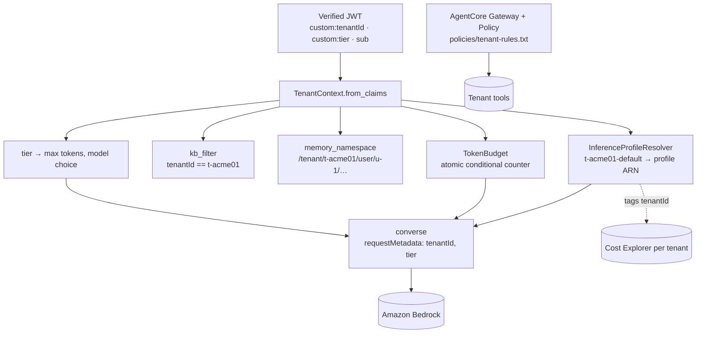

# Lab 48 · Multi-tenant AI features on Bedrock — isolation, cost and budgets per tenant

> **Outcome:** A small, tested library ([`app/tenant_ai.py`](app/tenant_ai.py)) that makes every AI call in your SaaS **tenant-bound**. It covers the right inference profile, a retrieval filter, a memory namespace, a tier limit and a budget charge. The per-tenant AI spend then shows up in Cost Explorer.

## Scenario

Adding AI to a multi-tenant product creates four new ways to fail:

1. **Leakage** across tenants, through RAG, memory or tool calls.
2. **Unattributable cost.** One IAM role calls Bedrock for everyone, so the bill can't be split by tenant.
3. **Noisy neighbours** at the token level.
4. **Unprofitable tiers.**

Each one needs a control enforced in code, not in the prompt.



## Controls

| Risk | Control in this lab |
| --- | --- |
| Spoofed tenant | `TenantContext.from_claims` accepts only verified claims (`custom:tenantId`, `custom:tier`) and rejects missing or unknown values |
| Cross-tenant RAG | `kb_filter()` → `{"equals": {"key": "tenantId", "value": ...}}`, combinable with your own filters via `andAll`. Tag each document with `tenantId` metadata at ingestion |
| Cross-tenant memory | `memory_namespace()` → `/tenant/{tenantId}/user/{userId}/{kind}` (pairs with Lab 28) |
| Cost attribution | One **application inference profile per tenant**, tagged `tenantId` and `tier` and created at onboarding (Lab 46) or backfilled with [`create_tenant_profiles.py`](app/create_tenant_profiles.py). `requestMetadata` also tags invocation logs |
| Runaway spend | `TokenBudget.charge()` reserves `maxTokens` before the call and trues up after, using an **atomic conditional** DynamoDB update, so concurrent requests can't race past the cap |
| Tier economics | `TIER_DEFAULTS` caps output tokens and monthly tokens per tier. Swap the base model per tier in the profile |
| Tool abuse | Cedar rules from plain English: [`policies/tenant-rules.txt`](policies/tenant-rules.txt). Every tool call's `tenant_id` must equal the caller's claim (Lab 30) |

## Step 1 — Run the tests

```bash
cd labs/48-multi-tenant-ai-on-bedrock/app && pytest -q      # 5 passed
```

The tests cover claim validation, paginated and cached profile lookup, the isolation helpers, budget exhaustion, and a converse call that uses the tenant's profile ARN, tags `requestMetadata`, applies the tier cap and trues up the budget.

## Step 2 — Create profiles and activate the tag

```bash
python create_tenant_profiles.py --base-model-arn arn:aws:bedrock:us-east-1::foundation-model/amazon.nova-lite-v1:0 \
  --tenants t-acme01:premium t-globex2:basic
```

Then in **Billing → Cost allocation tags**, activate `tenantId`. The default quota is 1,000 application inference profiles per Region per account (adjustable). For very large tenant counts, use profiles per tier and attribute with invocation-log metadata.

## Step 3 — Use it in an agent

```python
ctx = TenantContext.from_claims(verified_claims)
model = BedrockModel(model_id=resolver.arn_for(ctx), max_tokens=TIER_DEFAULTS[ctx.tier]["max_output_tokens"])
agent = Agent(model=model, tools=[search_docs_for(ctx)], trace_attributes=tenant_span_attributes(ctx.tenant_id, ctx.tier))
```

Here `search_docs_for(ctx)` is a closure tool that always applies `kb_filter(ctx)`. The filter is never a parameter the model can change.

## Step 4 — Prove it

Run Lab 45's `tenant-isolation-tests` skill against the AI endpoints (the RAG, memory and agent-tool rows), and check per-tenant spend with the `tenant-cost-report` skill a day later.

## Learn more

- [Manage multi-tenant Bedrock costs with application inference profiles](https://aws.amazon.com/blogs/machine-learning/manage-multi-tenant-amazon-bedrock-costs-using-application-inference-profiles/) · [Multi-tenant generative AI gateway guidance](https://aws.amazon.com/solutions/guidance/multi-tenant-generative-ai-gateway-with-cost-and-usage-tracking-on-aws) · [Bedrock cost playbook for FinOps](https://aws.amazon.com/blogs/machine-learning/managing-amazon-bedrock-costs-end-to-end-a-playbook-for-finops-and-platform-teams/)
