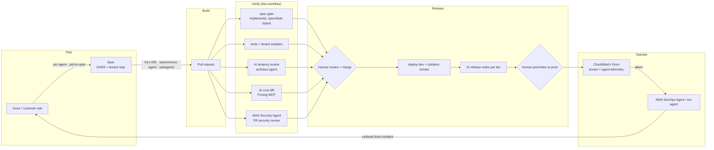

# Lab 49 · The AI-first SDLC pipeline — every persona automated, humans at the gates

> **Outcome:** One pipeline where each lifecycle stage has an AI worker and a human gate. Intent (specs) is traceable to code, tenant isolation is tested on every change, architecture, security and cost are reviewed automatically, and production feedback flows back into the backlog.

## The lifecycle



## Persona × stage automation

| Stage | Persona | AI worker | Kiro / AWS pieces | Human gate |
| --- | --- | --- | --- | --- |
| Intake & plan | PM | `pm` agent, `prd-to-spec` | Specs, Smartsheet/Jira MCP (Lab 42) | Approve requirements |
| Design | Architect | `architect`, `tenancy-review` | Design-first specs, AWS Knowledge MCP | Approve design |
| Build | Developer | Kiro IDE/CLI, subagents, autonomous agent | Steering, skills, hooks (Labs 02–07, 14) | PR review |
| Traceability | EM / PM | `spec_gate.py` | `tasks.md` ticks | — (hard gate) |
| Test | QA | `qa`, `tenant-isolation-tests` | `npm run test:isolation` | — (hard gate) |
| Security | Security | AWS Security Agent (design + PR review), `threat-model` skill | Hooks, Policy (Lab 30) | Security sign-off for high risk |
| Cost | FinOps | Kiro + `estimate-before-build` | Pricing MCP, `cdk diff` | Budget owner for large deltas |
| Release | Release mgr | `release-manager` agent | Tags, notes per tier | Promote to prod |
| Operate | SRE | CloudWatch Omni + AWS DevOps Agent, `sre` agent, Crew heartbeat | Lab 47 | Incident commander |
| Learn | Everyone | `runbook-from-incident`, Crew bots | Backlog, evals | Prioritization |

## Step 1 — The traceability gate

[`scripts/spec_gate.py`](scripts/spec_gate.py) requires `Implements: <spec>#<task>` in the PR body or commits, and the task must be **ticked** in `.kiro/specs/<spec>/tasks.md`. It is exempt only with `spec-exempt: <reason>`.

```bash
cd labs/49-ai-sdlc-pipeline/scripts && pytest -q            # 2 passed
python spec_gate.py --text "Implements: order-notifications#1.1" --root ../../03-spec-driven-development
```

That second command checks against Lab 03's real spec, where task 1.1 is still unticked, so it exits 1. That's the point: unfinished work can't merge.

## Step 2 — Install the workflow

```bash
cp labs/49-ai-sdlc-pipeline/workflows/ai-sdlc.yml .github/workflows/
cp labs/49-ai-sdlc-pipeline/scripts/spec_gate.py scripts/
cp -r labs/45-ai-first-persona-kit/.kiro/{agents,skills} .kiro/
```

The workflow [`ai-sdlc.yml`](workflows/ai-sdlc.yml) has six jobs:

1. `spec-gate`
2. `test`, which includes isolation tests
3. `ai-review` (headless Kiro, `architect` agent, single PR comment)
4. `cost-diff` (OIDC read-only role, `cdk diff` priced by Kiro)
5. `deploy-dev` (on `main`, plus an isolation smoke test against dev)
6. `release-notes`

Enable **AWS Security Agent** PR and design review on the repo for an independent, AWS-managed security pass.

## Step 3 — Close the loop

- **Omni → backlog:** alarm → `sre` agent with `tenant-incident` (Lab 47) → `runbook-from-incident` → issue labelled `kiro` → autonomous agent drafts the fix PR (Lab 14) → this pipeline.
- **Evals → backlog:** low-scoring agent sessions in Omni or AgentCore Evaluations (Lab 32) become eval cases and spec tasks.

## Measuring an AI-first SDLC

| Metric | Why |
| --- | --- |
| DORA (lead time, deploy frequency, change failure rate, MTTR) | Did AI make delivery better, not just busier? |
| % PRs with a spec reference; spec drift findings | Intent stays the source of truth |
| Isolation test coverage of endpoints and AI features | The multi-tenant safety net |
| AI review precision (accepted vs dismissed comments) | Trust calibration |
| Cost per PR review / per agent task | AI cost stays bounded |

## Learn more

- [AWS Security Agent](https://aws.amazon.com/about-aws/whats-new/2026/03/aws-security-agent-ondemand-penetration) · [CloudWatch Omni](https://aws.amazon.com/about-aws/whats-new/2026/09/amazon-cloudwatch-omni-ai/) · [Lab 10 — headless Kiro](../10-headless-kiro-in-ci/README.md) · [AI-first SaaS playbook](../../docs/ai-first-saas-playbook.md)
