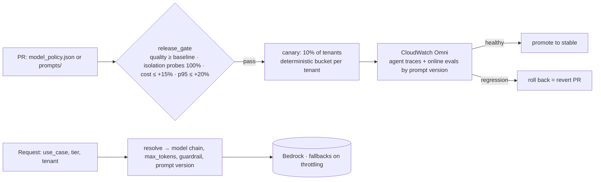

# Lab 50 · An AI engineering platform for SaaS — routing, prompt versions, canaries, release gates

> **Outcome:** Changing a model or prompt becomes a normal, reviewable PR. The change is evaluated against the stable baseline, passes every tenant-isolation probe, stays within cost and latency budgets, rolls out to a deterministic 10 % of tenants, and is watched in CloudWatch Omni.

## Scenario

In an AI-first SaaS, prompts and model choices change weekly, and each change can shift quality, cost and safety for **every tenant** at once. AI engineering needs the same discipline as code: versioning, review, gates and progressive delivery. And it has to be **tier-aware**: basic tenants on cheap models, enterprise tenants on the best one.



## The control plane (all in git)

| File | Purpose |
| --- | --- |
| [`model_policy.json`](platform/model_policy.json) | Per use case × tier: primary model, fallbacks, `max_tokens`, guardrail id; `*` wildcard; canary config |
| [`prompts/registry.json`](platform/prompts/registry.json) | Versioned prompts per use case; `stable` pointer; each version links its eval record |
| [`prompts/support-answer/v3.md`](platform/prompts/support-answer/v3.md) | Candidate prompt adding citations, tenant scoping and a length limit |
| [`evals/*.json`](platform/evals/support-answer-v3.json) | Eval results: pass rate, faithfulness, isolation probes, p95, cost per 1k requests |
| [`router.py`](platform/router.py) | `resolve()`, `in_canary()`, `call_with_fallback()`, `release_gate()` |

Model IDs in the policy are examples. Check what's enabled in your account with `aws bedrock list-inference-profiles`, and combine with Lab 48's per-tenant application profiles for cost attribution.

## Step 1 — Run the tests

```bash
cd labs/50-ai-engineering-platform/platform && pytest -q     # 6 passed
```

The tests cover:

- tier routing and the wildcard;
- canary determinism and size (a ~10 % bucket over 5,000 tenants);
- the prompt version following the canary;
- the fallback chain on throttling;
- the release gate for v3;
- a consistency check that every routed use case has a registered prompt.

That last check caught a real bug while this lab was being written.

## Step 2 — Ship a prompt change the AI-first way

```bash
kiro-cli --agent ai-engineer          # Lab 45
```
```text
> Draft support-answer v4 that asks a clarifying question when the context is ambiguous.
  Run the ai-feature-eval skill on the golden set, write evals/support-answer-v4.json,
  run release_gate("support-answer","v4"), and if it passes open a PR setting canary to v4 at 10%.
```

CI runs `pytest` (the gate) as part of Lab 49's pipeline. After merge, CloudWatch Omni (Lab 47) compares online evaluation scores and latency **by prompt version**. To roll back, revert the PR.

## Step 3 — Guardrails per route

Create Bedrock Guardrails (`gr-basic`, `gr-standard`) with denied topics, PII filters and prompt-attack filters, then pass the id from the route into the model call (`BedrockModel(guardrail_id=..., guardrail_version=...)` in Strands). Tenants on different tiers or regulated tenants can get stricter guardrails without code changes.

## What else belongs on the platform

| Capability | AWS / Kiro piece | Lab |
| --- | --- | --- |
| Per-tenant cost and budgets | Application inference profiles, `TokenBudget` | 48 |
| Agent hosting, tools, memory, identity | AgentCore Runtime, Gateway, Memory, Identity | 26–29 |
| Deterministic tool policy | AgentCore Policy | 30 |
| Offline and online evaluation | Strands Evals, AgentCore Evaluations, Omni evaluators | 25, 32, 47 |
| Fine-tuning when prompting isn't enough | SageMaker AI skills via Kiro | 44 |
| Skills as shared domain knowledge | Agent Skills across Kiro, Strands and AgentCore | 41, 45 |

## Learn more

- [Bedrock Guardrails](https://docs.aws.amazon.com/bedrock/latest/userguide/guardrails.html) · [CloudWatch Omni](https://aws.amazon.com/about-aws/whats-new/2026/09/amazon-cloudwatch-omni-ai/) · [AI-first SaaS playbook](../../docs/ai-first-saas-playbook.md)
