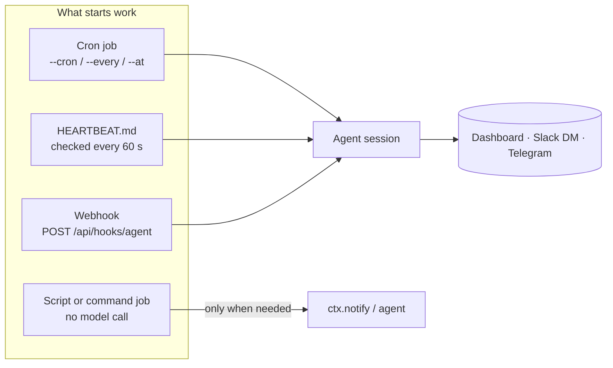

# Lab 51 · Kiro Crew scheduling — cron jobs, heartbeats and webhooks

> **Outcome:** A weekday morning briefing, a zero-token disk check, a script job that watches CI and only wakes the model when something is red, a heartbeat that watches a pull request, and a webhook your tooling can call.

## Scenario

Your team wants the assistant to *show up* before standup: summarize open work, catch red builds, and react to events — without paying for a model call every five minutes. Kiro Crew has four ways to start work without you typing, and picking the right one is mostly a cost decision.



## How it works

| Trigger | Use it when | Cost | Where it lives |
| --- | --- | --- | --- |
| **Agent cron job** | The job needs reasoning (summaries, triage) | One agent run per fire | `~/.kiro/crew/crons.json` |
| **Script job** (`--script file.py:run`) | A deterministic check that only sometimes needs attention | No model call | `~/.kiro/crew/crons/` |
| **Command job** (`--command`) | A shell one-liner (`df -h`, a curl health check) | No model call | `crons.json` |
| **Heartbeat** | "Watch X until it changes" | One run per task per tick until it succeeds | `~/.kiro/crew/workspace/HEARTBEAT.md` |
| **Webhook** *(Feature Preview)* | Another system should start the work | One run per call | Settings → Webhooks |

Rules worth knowing (from the Crew scheduling docs):

- Each cron run gets **its own session**. Use `--no-persistent-session` so context doesn't pile up across runs.
- Always pass `--timezone` for wall-clock schedules. Without it the gateway's timezone (or UTC) is used.
- Crew **does not replay missed intervals** after a restart.
- Cron runs never carry per-run trust. Denied commands and sensitive-path blocks still apply.
- A script returns quietly with `raise Skip()` (try again next tick) or removes its own job with `raise Done()`. `ctx.notify()` sends a message; `ctx.call_tool()` calls an MCP tool.

## Step 1 — An agent cron job

In the dashboard, open **Schedule → Add**, or just ask in chat: *"Every weekday at 9, summarize my open work."* The CLI equivalent:

```bash
kirocrew cron add "morning-briefing" \
  "Summarize my open PRs, failing checks and issues assigned to me in <owner>/<repo>. Five bullets max." \
  --cron "0 9 * * 1-5" --timezone "Europe/London" --no-persistent-session
kirocrew cron list
kirocrew cron trigger <id>     # run it now to test
```

## Step 2 — A command job (no model call)

```bash
kirocrew cron add "disk-check" "disk usage" --every 600 --command "df -h /" --timeout 30
```

## Step 3 — A script job that wakes the model only when needed

Copy [`crons/ci_watch.py`](crons/ci_watch.py) into `~/.kiro/crew/crons/`. It runs `gh run list` for one repo. If the latest runs are green it raises `Skip` (silent). If one failed, it calls `ctx.notify` with the failing workflow and URL.

```bash
cp crons/ci_watch.py ~/.kiro/crew/crons/
kirocrew cron add "ci-watch" "watch CI" \
  --script ~/.kiro/crew/crons/ci_watch.py:run --every 900 \
  --no-persistent-session --minimal-context
```

> `gh` must be signed in on the gateway host. Set the repo with the `CI_WATCH_REPO` variable in the script, or edit the default.

Ask Crew to review your jobs for cost. The built-in `cron-cost-optimize` skill recommends script, minimal-context or full-context execution, and it never changes a job on its own:

```text
> Use the cron-cost-optimize skill on my scheduled jobs and tell me which should become scripts.
```

## Step 4 — A heartbeat watch

Append the tasks from [`HEARTBEAT.example.md`](HEARTBEAT.example.md) to `~/.kiro/crew/workspace/HEARTBEAT.md`, or say in chat: *"Watch PR #42 and tell me when review comments land."* The heartbeat reads the file every 60 seconds and runs tasks in parallel. A task that succeeds is cleared; a failed one retries on the next tick. To send a result to a Slack channel instead of the default, add `<!-- deliver:C0123CHANNEL -->` after the task.

## Step 5 — A webhook *(Feature Preview)*

1. Turn on **Settings → Developer → Feature Previews → Webhooks**. A **Webhooks** tab appears in Settings.
2. Create a token. It starts with `kc_whk_`, is shown once and is stored hashed.
3. Call it with [`scripts/webhook.sh`](scripts/webhook.sh):

```bash
export KIROCREW_WEBHOOK_TOKEN=kc_whk_...   # never commit it
./scripts/webhook.sh "Deployment 2026-11-25.3 finished in staging. Smoke-test the checkout flow and report."
```

Limits: up to 20 tokens, 6 concurrent webhook sessions, and a 10-minute default timeout (`timeoutSeconds` raises it to about an hour). The gateway binds to loopback, so callers on other machines need a tunnel (see [Lab 57](../57-crew-24x7-on-aws/README.md)).

## Verify

- [ ] `kirocrew cron list` shows `morning-briefing`, `disk-check` and `ci-watch`
- [ ] Each job's **Logs** tab shows an OK run after `kirocrew cron trigger <id>`
- [ ] `ci-watch` stays silent on a green repo and notifies on a red one
- [ ] The heartbeat task disappears from `HEARTBEAT.md` once the PR has comments
- [ ] The webhook call returns and its session appears in the dashboard

## Clean up

```bash
kirocrew cron remove <id>      # per job, or: kirocrew cron remove-all
```

Revoke the webhook token in Settings → Webhooks.

## Learn more

- [Crew scheduling docs](https://kiro.dev/docs/crew/features/cron/) · [Crew quick start](https://kiro.dev/docs/crew/)
- [`src/kiro_crew/cron_script.py`](https://github.com/kirodotdev/KiroCrew/blob/main/src/kiro_crew/cron_script.py) — the script-job contract
- Next: [Lab 52 — Task Runner: unattended, spec-driven work](../52-crew-task-runner-overnight/README.md)
