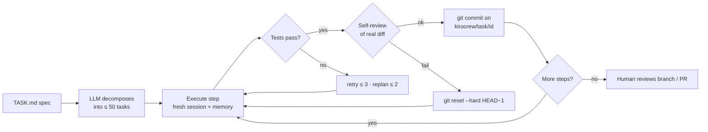

# Lab 52 · Kiro Crew Task Runner — unattended, spec-driven work

> **Outcome:** A multi-step change (add an API endpoint, tests and docs) built overnight by the Task Runner on branch `kirocrew/task/<id>`, with one commit per passed step and a human approval before anything is published.

## Scenario

Some work is too long for one chat turn: migrations, refactors across many files, "add pagination to every list endpoint". The Task Runner is built for that: "designed for 10+ hours of unattended operation". You write the spec; it decomposes the work, executes each step in a fresh session, runs your tests, reviews the actual diff, and commits or reverts.



## How it works

| Behaviour | Value (Task Runner docs) |
| --- | --- |
| Loop | Spec → decompose → execute → test → self-review → commit or retry |
| Git | Branch `kirocrew/task/{task_id}`, in a worktree when the folder is a repo. One commit per passed step |
| Limits | 3 retries per step, 2 recoveries, 2 replans, 50 tasks max; 3 steps in parallel; 3 concurrent runs |
| Watchdog | Warning after 60 min idle; session reset after 2 h |
| Approval | A step marked **force approval** blocks "even in YOLO mode". Use it for deploy, delete, publish and `rm -rf` |
| Auto-approve | Per-run dashboard toggle with a TTL (6 h max, 24 h hard ceiling). It never applies to cron- or MCP-launched runs |
| State | `~/.kiro/crew/tasks/runs.json`; git-coordinated runs resume automatically after a crash, others reopen as **Paused** |

## Step 1 — Write the spec

Copy [`TASK.md`](TASK.md) into the root of a repo you own and edit it. Any markdown works; `## Goal`, `## Requirements` and `## Acceptance criteria` give the planner the most to work with. Keep acceptance criteria **testable**: the runner verifies with your test command, not with vibes.

## Step 2 — Start the run

From the dashboard, open **Projects**, paste the spec in the Compose area (optionally **✨ Refine**), review the plan and press **Run**. Or from a terminal in the repo:

```bash
kirocrew run TASK.md                 # resumes from its checkpoint if re-run
kirocrew run TASK.md --timeout 3600  # cap the run
```

You can also start it from Slack (`run TASK.md`) or let an agent start it with the `task_run` MCP tool.

## Step 3 — Gate the risky steps

In the plan review, mark any step that publishes, deploys or deletes as **force approval**. Leave auto-approve **off** for the first runs. When a gated step is reached, the run waits for you in the dashboard (or Slack) and continues once you approve.

## Step 4 — Watch, pause, steer

- The **Projects** panel streams each step, its test result and its commit.
- Pause from Slack with `run pause <task_id>`, or cancel with `kirocrew run cancel <task_id>`.
- If a step keeps failing, the runner replans (up to twice) before it stops and asks you.

## Step 5 — Review like any other PR

```bash
git log --oneline kirocrew/task/<task_id>
git diff main...kirocrew/task/<task_id>
gh pr create --base main --head kirocrew/task/<task_id> --fill --draft
```

Treat the branch as a contributor's work: CI, code review ([Lab 55](../55-crew-engineering-apps/README.md)), then merge.

## Verify

- [ ] The run produced branch `kirocrew/task/<task_id>` with one commit per completed step
- [ ] Every acceptance criterion in `TASK.md` maps to a passing test
- [ ] The force-approval step waited for you
- [ ] Killing the gateway mid-run and restarting it resumed (git-coordinated) or paused the run

## Clean up

Delete the branch and worktree once merged: `git worktree prune && git branch -D kirocrew/task/<task_id>`.

## Learn more

- [Task Runner docs](https://kiro.dev/docs/crew/features/task-runner/) · [TaskRunner spec](https://github.com/kirodotdev/KiroCrew/blob/main/docs/system-specs/modules/taskrunner.md)
- Compare with interactive specs in Kiro: [Lab 03](../03-spec-driven-development/README.md)
- Next: [Lab 53 — Workflows and PR babysitting](../53-crew-workflows-pr-babysitting/README.md)
