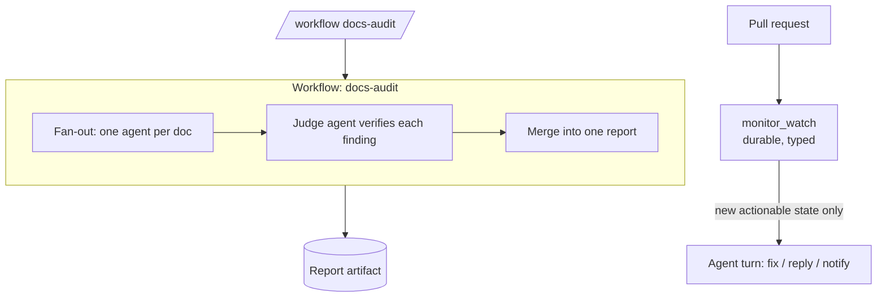

# Lab 53 · Kiro Crew workflows and PR babysitting

> **Outcome:** A reusable `/workflow docs-audit` that fans out one agent per doc, has a judge agent verify every finding, and returns one report. Plus a pull request that Crew watches until it is merge-ready, spending no agent turns while nothing changes.

## Scenario

Subagents (`spawn_run`) are great for "research these three options in parallel". When the shape of the work is fixed and repeatable (*every* file, *then* a review, *then* a verdict), you want it written down and versioned. That is a **workflow**: a Python script, usually written for you by an agent from a plain-English goal, that drives several Crew agents through ordered stages. The other repeatable chore is **babysitting a PR**: re-running flaky checks, answering review comments, telling you when it's green.



## How it works

| Piece | What it is |
| --- | --- |
| **Workflows app** | Bundled, disabled by default. Enable with `kirocrew app enable workflows`; the page is at `/workflows` |
| **Script** | One Python module with a literal `META` dict and an `async def workflow(ctx)` entry point. It is statically checked against a sandboxed command set *before* it runs |
| **Patterns** | Fan-out, pipeline, judge-and-verify |
| **Library** | **Customize → Workflows** (0.13.0+): versioned, with rollback; run with `/workflow <name>` |
| **MCP tools** | `workflow_author`, `workflow_run`, `workflow_status`, `workflow_result`, `workflow_cancel`, `workflow_library_list` |
| **PR watch** | `monitor_watch` creates a durable monitor. The controller probes the provider *before* calling the model and wakes the session only on a new actionable state. `monitor_start` is the prompt-loop fallback for things the provider can't decide |
| **Limits** | Chat turns up to 4 h; monitors run up to `monitoring.max_runtime_secs` (7 days by default, 30 max) |

## Step 1 — Enable the app

```bash
kirocrew app enable workflows
```

(If the CLI refuses, toggle **Apps → Library → Workflows** in the dashboard.)

## Step 2 — Have an agent author the workflow

In a chat, say what you want, not how to script it:

```text
> Write a workflow called docs-audit. For every markdown file under docs/, run one agent that
  lists broken links, outdated CLI flags and missing prerequisites with file:line evidence.
  Then run a judge agent that re-checks each finding and drops anything it cannot reproduce.
  Merge the surviving findings into one report grouped by file, and save it as an artifact.
```

The agent writes the script and the engine validates it statically. Read it on the `/workflows` page before the first run, then save it to the library.

## Step 3 — Run it and watch the stages

```text
> /workflow docs-audit
```

The page streams each stage and agent event. Compare the judge's dropped findings with the raw ones: that's your false-positive rate.

## Step 4 — Babysit a pull request

`monitor_watch` needs an authenticated host CLI: `gh` for GitHub (`glab` for GitLab, `az` with the azure-devops extension for Azure DevOps).

```text
> Babysit PR #128 in owner/repo until it is merge-ready. Re-run failed checks once if the
  failure looks flaky, answer review comments that only need a factual reply, and ask me
  before pushing any code. Tell me in Slack when it's green and approved.
```

Crew arms a structured watch. While the PR is unchanged it spends no agent turns; a new review, comment or check result wakes the session.

## Step 5 — Stop and inspect

```text
> Show my active monitors.      (monitor_inspect)
> Stop watching PR #128.        (monitor_stop)
```

## Verify

- [ ] `docs-audit` appears in **Customize → Workflows** with a version
- [ ] The run page shows the fan-out, judge and merge stages
- [ ] The judge dropped at least one unreproducible finding (or you can explain why none)
- [ ] The PR monitor woke the agent only on real changes (check the session's turn count)

## Clean up

Stop monitors you no longer need. Disable the app with `kirocrew app disable workflows` if you're done.

## Learn more

- [Workflows docs](https://kiro.dev/docs/crew/features/workflows/) · [Dynamic workflows spec](https://github.com/kirodotdev/KiroCrew/blob/main/docs/system-specs/modules/workflows.md) · [Babysit PR watch spec](https://github.com/kirodotdev/KiroCrew/blob/main/docs/system-specs/modules/babysit-pr-watch.md)
- Subagents and parallel work in Kiro: [Lab 06](../06-subagents-and-parallel-work/README.md)
- Next: [Lab 54 — Build your first Kiro Crew app](../54-crew-build-your-first-app/README.md)
