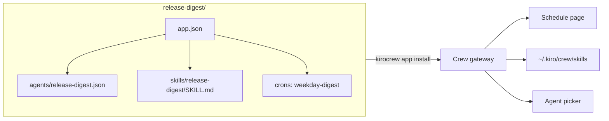

# Lab 54 · Build your first Kiro Crew app

> **Outcome:** A working `release-digest` app — agent + skill + weekday cron — installed in your Crew, editable by your team, and shareable as a git repository.

## Scenario

Your team keeps re-creating the same agent, skill and schedule on every laptop. In Kiro Crew, an **app** is "a package that contributes any combination of agents, skills, MCP servers, cron jobs, dashboard UI pages, or backend processes". Package once, install everywhere.



## How it works

| Manifest field | Notes (App Kit manifest reference) |
| --- | --- |
| `name`, `version`, `displayName`, `description` | Required. `name` is kebab-case; reserved names such as `library`, `registry` and `system` are refused |
| `agents`, `skills` | Relative paths inside the app. Skills are linked into `~/.kiro/crew/skills/` |
| `crons` | Each needs a `name`, `every` *or* `cron_expr`, and an `agent`, `message`, `command` or `script`. **Requires `"permissions": {"cron": true}`** |
| `useCases` | 3–5 "when X, do Y" situations that name what the app declares |
| `mcpServers`, `ui`, `backend` | Optional: tools, dashboard pages and a backend process (proxied at `/apps/<name>/api/*`) |
| `permissions` | `api` is enforced; `events`, `mcpTools`, `storage`, `cron`, `network` are advisory today |

> **Trust model.** Third-party apps are disabled by default. An app's backend Python runs inside the gateway process with the gateway's privileges. Read an app before you enable it, the same way you'd read a VS Code extension.

## Step 1 — Read the example app

Open [`release-digest/app.json`](release-digest/app.json), the [agent](release-digest/agents/release-digest.json) and the [skill](release-digest/skills/release-digest/SKILL.md). Change `owner/repo` in the skill and the timezone in the cron.

## Step 2 — Install it

```bash
kirocrew app install ./release-digest
kirocrew app list
kirocrew app info release-digest
```

Enable it in **Apps → Library** (or `kirocrew app enable release-digest`). The `weekday-digest` job appears on the **Schedule** page; the agent appears in the agent picker.

## Step 3 — Test without waiting for Monday

```bash
kirocrew cron list                 # find the weekday-digest id
kirocrew cron trigger <id>
```

Or open a chat with the `release-digest` agent and say *"Write today's digest."*

## Step 4 — Iterate

Edit the skill and run again: skills are plain markdown your team owns. When you change the manifest (for example the cron time), update the app from its page in the dashboard. Fields you changed are re-applied, and a user's pause is kept.

## Step 5 — Share it

Push the folder to a git repo. Teammates install with:

```bash
kirocrew app install https://github.com/<you>/release-digest.git
```

To start a bigger app with a UI, scaffold one: `kirocrew app init my-dashboard --ui`.

## Verify

- [ ] `python3 -m json.tool release-digest/app.json` passes (this lab's manifest was checked that way)
- [ ] `kirocrew app info release-digest` shows the agent, the skill and the cron
- [ ] A triggered run produced a digest with a link for every claim
- [ ] The agent never commented, labelled or merged anything

## Clean up

Uninstall from the app's page in the dashboard; its cron jobs are removed with it.

## Learn more

- [Crew apps docs](https://kiro.dev/docs/crew/apps/) · [App Kit getting started](https://github.com/kirodotdev/KiroCrew/blob/main/docs/app-kit/getting-started.md) · [Manifest reference](https://github.com/kirodotdev/KiroCrew/blob/main/docs/app-kit/manifest-reference.md)
- Skills in Kiro: [Lab 07](../07-agent-skills/README.md)
- Next: [Lab 55 — Engineering apps: triage, review, specs and auto-improvement](../55-crew-engineering-apps/README.md)
