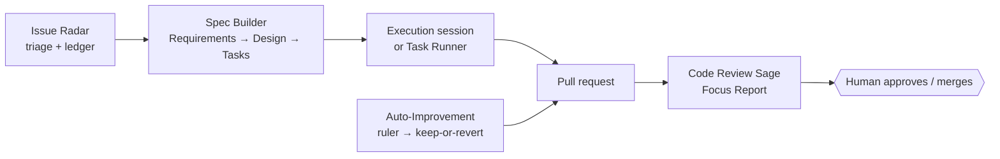

# Lab 55 · Kiro Crew engineering apps — triage, review, specs and auto-improvement

> **Outcome:** One repository wired into four built-in apps: issues triaged with remembered findings, PRs reviewed with a Focus Report, a feature specced and handed to an execution session, and a measured performance fix drafted as a PR.

## Scenario

A small team owns a busy repo. Every morning: new issues to label, PRs to review, a feature to plan and a backlog of "it's slow" complaints. Kiro Crew ships purpose-built apps for each, all **off by default** and all using *your own* `gh` / `glab` / `az` session, so Crew holds no PAT.



## How it works

| App (`name`) | What it does | Guard rails |
| --- | --- | --- |
| **Issue Radar** (`issue-radar`) | Browse, filter and triage GitHub, GitLab and Azure DevOps issues and PRs. AI summaries and suggested labels; per-item findings kept in a local ledger "so nothing gets re-investigated". Approve, merge or re-run CI from the app | Uses your `gh`/`glab`/`az` login; merges still need the host's required reviews and checks |
| **Code Review Sage** (`code-review-sage`) | Reviews each PR in its own isolated session, weighted by blast radius, rolled into a prioritized **Focus Report**. Learns your standards from shipped fixes and past comments | Findings stay in the app until you publish them as a **draft** review (or turn on auto-posting) |
| **Spec Builder** (`spec-builder`) | Turns an idea into Requirements → Design → Tasks with an embedded agent, then hands the approved plan to an autonomous execution session | You approve the markdown first |
| **Auto-Improvement** (`auto-improvement`) | Designs a metric (the "ruler"), proves it detects a known win, then runs keep-or-revert cycles in isolated worktrees, gated by an edit allowlist and your tests | Survivors become **draft** PRs; "the agent never grades its own work" |

## Step 1 — Prerequisites

```bash
gh auth status            # GitHub CLI signed in on the gateway host
kirocrew doctor
```

## Step 2 — Triage with Issue Radar

Enable **Apps → Discover → Issue Radar**, connect `owner/repo`, then:

1. Filter to *open, unlabelled, last 7 days*.
2. Read each AI summary and accept or edit the suggested labels.
3. On anything you investigate, write a finding. Next time the same report shows up, open the notes instead of starting over.
4. Optional: turn on the background watcher to be notified about new issues.

## Step 3 — Spec the top issue

Enable **Spec Builder**. Paste the issue and iterate on Requirements → Design → Tasks in-app. When the tasks look right, hand off to an execution session. For long, multi-hour work, use the Task Runner instead ([Lab 52](../52-crew-task-runner-overnight/README.md)).

## Step 4 — Review with Code Review Sage

Enable **Code Review Sage** and point it at the new PR (or any open PR). Read the Focus Report top-down: high-blast-radius files first. Publish selected findings as a **draft** GitHub review, then edit and submit it yourself.

## Step 5 — A measured improvement

Enable **Auto-Improvement** on a repo with a reproducible benchmark (for example a test suite's wall time or an endpoint's p95 in a local load test):

1. Let it design the ruler and **prove** it against a known win before any cycle runs.
2. Restrict the edit allowlist to the module you're willing to change.
3. Review the draft PRs it opens. Each one carries the measured win and the noise band it cleared.

## Verify

- [ ] Issue Radar's ledger has findings for the issues you investigated
- [ ] Spec Builder produced `requirements.md`, `design.md` and `tasks.md` you approved
- [ ] Code Review Sage's draft review exists only because you published it
- [ ] Auto-Improvement's PRs are drafts with before/after measurements

## Clean up

Disable apps you won't keep using (**Apps → Library**). Close draft PRs you don't want.

## Learn more

- [Crew apps](https://kiro.dev/docs/crew/apps/) · [Issue Radar spec](https://github.com/kirodotdev/KiroCrew/blob/main/docs/system-specs/modules/issue-radar.md) · [Auto-Improvement spec](https://github.com/kirodotdev/KiroCrew/blob/main/docs/system-specs/modules/auto-improvement.md)
- Bots that own these chores long-term: [Lab 13](../13-kiro-crew-bots/README.md)
- Next: [Lab 56 — Ops Mission Control on AWS](../56-crew-ops-mission-control/README.md)
