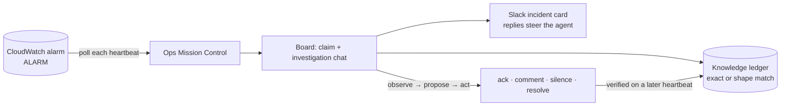

# Lab 56 · Kiro Crew Ops Mission Control — an AI first responder for CloudWatch alarms

> **Outcome:** A test CloudWatch alarm fires, Ops Mission Control claims it, investigates in a chat you can watch, mirrors a live incident card to Slack, records the fix in its ledger, and the second occurrence is faster than the first.

## Scenario

On-call is mostly the same few alarms. Ops Mission Control is "an autonomous ops first responder": it polls your signal providers, **claims** what is firing, investigates with real context, proposes a fix, and remembers what worked. It is **read-only by default**.



## How it works

| Concept | Detail (from the app's README) |
| --- | --- |
| Tabs | **Board** (live work), **Signals** (per-source health, unclaimed firing signals), **Handover** (what's waiting on a person, what recurs), **Settings** |
| AWS credentials | Your ambient profile chain. "No key is ever stored." |
| Autonomy | `observe` (default, writes nothing) → `propose` (drafts the action and asks) → `act` (only for signal patterns allowlisted by a rule naming a source plus a resource glob or label) |
| Actions | `ack`, `comment`, `silence` (bounded: 4 h default, 24 h ceiling — grant this first), `resolve` |
| Ledger | Matches by the provider's identity (for CloudWatch, the alarm name) or a shape fingerprint. A remembered fix is offered directly only when it is verified, high-confidence, used at least twice and has never failed |
| Verification | After an action, a later heartbeat re-reads the signal. A provider's 2xx means "your request arrived", not "it worked" |

## Step 1 — Least-privilege AWS identity

Give the gateway host a role or profile with **read-only** CloudWatch access for the observe phase (for example the AWS managed `CloudWatchReadOnlyAccess` policy). Add `cloudwatch:SetAlarmState` only when you reach Step 6 in a sandbox account.

## Step 2 — Enable and connect

1. **Apps → Discover → Ops Mission Control → Install → Enable**.
2. **Settings → Providers** → turn on **AWS CloudWatch** (no credential needed).
3. Optional: **Settings → Slack** to mirror incidents (uses the Slack connection Crew already has — see [Lab 12](../12-kiro-crew-workspace/README.md)).

## Step 3 — Fire a safe test alarm

[`scripts/test-alarm.sh`](scripts/test-alarm.sh) creates a harmless alarm on a custom metric and forces it into `ALARM`:

```bash
AWS_REGION=us-east-1 ./scripts/test-alarm.sh create
AWS_REGION=us-east-1 ./scripts/test-alarm.sh fire
```

Wait one heartbeat or press **Poll & claim**. Watch the claim appear on the **Board** and open its investigation chat.

## Step 4 — Steer the investigation

Reply in the chat (or in the Slack thread) with context the agent can't see: *"This metric is synthetic from a lab. Confirm there is no customer impact and record the runbook: silence for 1 h."* The investigation ends with a proposed fix and a ledger entry.

## Step 5 — Fire it again

```bash
AWS_REGION=us-east-1 ./scripts/test-alarm.sh fire
```

The brief now says it found an **exact** ledger match (same alarm name) and starts from the recorded fix instead of re-deriving it.

## Step 6 — Graduate autonomy (sandbox account only)

Switch to `propose` and approve the drafted `silence`. Then add an `act` rule that names the CloudWatch source **and** the `KiroReinvent-Lab56-*` resource glob. "Act on everything" is deliberately impossible. Fire once more and confirm the bounded silence was applied, audited and verified on a later heartbeat.

## Verify

- [ ] The alarm was claimed and investigated in a chat you could reply to
- [ ] The Slack card updated in place and your thread reply reached the agent (if Slack is on)
- [ ] The second occurrence cited an exact ledger match
- [ ] In `act` mode only the allowlisted alarm was silenced, with an expiry

## Clean up

```bash
AWS_REGION=us-east-1 ./scripts/test-alarm.sh delete
```

Revoke any provider credentials in **Settings** before uninstalling (stored secrets survive an uninstall by design).

## Learn more

- [Ops Mission Control README](https://github.com/kirodotdev/KiroCrew/blob/main/src/kiro_crew/apps/builtins/ops_mission_control/README.md) · [Crew apps](https://kiro.dev/docs/crew/apps/)
- An SRE swarm built from scratch: [Lab 35](../35-e2e-sre-crew/README.md) · CloudWatch MCP: [Lab 19](../19-observability-with-mcp/README.md)
- Next: [Lab 57 — Run Kiro Crew 24/7 on AWS](../57-crew-24x7-on-aws/README.md)
