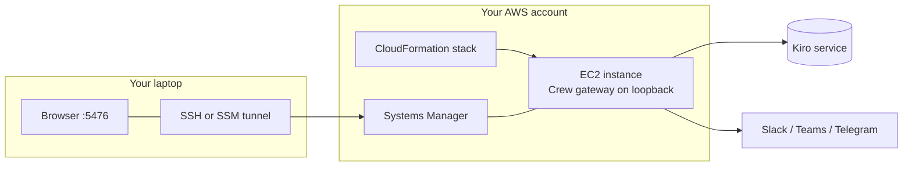

# Lab 57 · Run Kiro Crew 24/7 — service, Docker, or your own EC2 with `kirocrew cloud`

> **Outcome:** A Crew gateway that survives reboots, a containerized one you could run on a NAS or server, and a hardened remote crew on EC2 with zero SSH ingress, reached from your laptop through an SSM tunnel.

## Scenario

Schedules, heartbeats, bots and Slack replies only happen while the gateway runs. A laptop lid closing is the most common "outage". Pick the hosting that fits: a local service, a container, or a box in **your own** AWS account.



## How it works

| Option | Commands | Restarts on crash / reboot | Notes |
| --- | --- | --- | --- |
| **Local service** | `kirocrew service install` | Yes (systemd on Linux, launchd on macOS) | The gateway runs as your user; sudo only writes the unit file |
| **tmux** | `tmux new -s kirocrew` → `kirocrew gateway` | No | Fine for a demo, not for 24/7 |
| **Docker** | `ghcr.io/kirodotdev/kirocrew:stable` | With `--restart` / compose | Signed provenance; no auto-update; sandbox is fail-closed |
| **Kiro Cloud (EC2)** | `kirocrew cloud launch` | Yes | CloudFormation + SSM; Crew stores no AWS credentials; `cloud` verbs are human-only, never agent tools |
| **Fargate** | hand-edited `fargate` block in `~/.kiro/crew/cloud.json` | Task lifetime | "Partly shipped": no wizard or CLI verb yet |

The gateway **binds to loopback by default**, so remote access always goes through a tunnel.

## Option A — Local service

```bash
kirocrew service install
kirocrew service status && kirocrew status
kirocrew logs -f
```

## Option B — Docker

```bash
docker run -d --name kirocrew --restart unless-stopped \
  -p 127.0.0.1:5476:5476 \
  -v kirocrew-home:/home/kirocrew \
  ghcr.io/kirodotdev/kirocrew:stable
docker exec -it kirocrew kiro-cli login            # one-time sign-in
docker exec kirocrew kirocrew token --ttl 2h        # mint a dashboard login link (expires in minutes)
gh attestation verify oci://ghcr.io/kirodotdev/kirocrew:stable --repo kirodotdev/KiroCrew
```

Pin a version tag or digest for reproducible deployments. Upgrade with `docker compose pull && docker compose up -d`. Channel tokens go in environment variables (`SLACK_BOT_TOKEN`, `SLACK_APP_TOKEN`, `KIROCREW_OWNER_ID`), never in the image. If the in-container sandbox probe fails, agent execution stays **off** unless you set `KIROCREW_ALLOW_UNSANDBOXED=1`. Don't, unless you understand the trade-off.

## Option C — Your own EC2 instance with `kirocrew cloud`

1. **Check prerequisites and permissions** (AWS CLI v2, the Session Manager plugin, a profile):

   ```bash
   kirocrew cloud doctor --profile <profile> --region us-east-1
   kirocrew cloud iam-policy          # prints the IAM policy the launcher needs
   ```

   An administrator runs `kirocrew cloud iam-boundary` once to pre-create the immutable permissions boundaries.

2. **Launch.** The wizard creates a CloudFormation stack, installs Crew, signs the box in over SSM and opens an SSM port-forward. The default size is the Graviton `m7g.2xlarge` "balanced" tier; `t4g.xlarge` (16 GB) is the smallest offered. The CLI prints the approximate hourly and monthly price for the tier you pick.

   ```bash
   kirocrew cloud launch --profile <profile> --region us-east-1
   kirocrew cloud status
   ```

   For enterprise sign-in on the box, pass your IAM Identity Center portal: `--identity-provider https://<org>.awsapps.com/start --idp-region us-east-1 --license pro`.

3. **Connect from your laptop** (no SSH, no inbound ports; access is IAM-controlled and CloudTrail-audited):

   ```bash
   kirocrew cloud connect      # SSM tunnel, then open the URL it prints
   ```

   To manage it from your local dashboard, add it under **Settings → Remote Crew** (connection method SSM or SSH).

4. **Pause the bill when idle:** `kirocrew cloud stop` stops compute; the disk still bills until you `destroy`.

## Reach it from a phone *(optional)*

Put a named HTTPS tunnel (Cloudflare Tunnel, ngrok or Tailscale Funnel) in front of the gateway, set `"dashboard": {"url": "https://…"}` in `~/.kiro/crew/config.json`, then ask Slack for `/kirocrew dashboard` to get a short-lived sign-in link.

## Verify

- [ ] After a reboot, `kirocrew status` (or `docker ps`) shows the gateway running
- [ ] A cron from [Lab 51](../51-crew-scheduling-heartbeats-webhooks/README.md) fired while your laptop was asleep
- [ ] The EC2 instance's security group has **no inbound rules** and you still reached the dashboard
- [ ] `gh attestation verify` succeeded for the image you run

## Clean up

```bash
kirocrew cloud destroy --tag <tag> --region us-east-1 --profile <profile>   # deletes the stack
kirocrew service uninstall
docker rm -f kirocrew && docker volume rm kirocrew-home                     # also deletes Crew data
```

## Learn more

- [Running 24/7](https://kiro.dev/docs/crew/running-24-7/) · [Remote crew on EC2](https://github.com/kirodotdev/KiroCrew/blob/main/docs/guides/remote-crew-on-ec2.md) · [Docker guide](https://github.com/kirodotdev/KiroCrew/blob/main/docs/guides/docker.md) · [Fargate lane](https://github.com/kirodotdev/KiroCrew/blob/main/docs/guides/remote-crew-on-fargate.md)
- Next: [Lab 58 — Govern Kiro Crew for a team](../58-crew-governance-for-teams/README.md)
