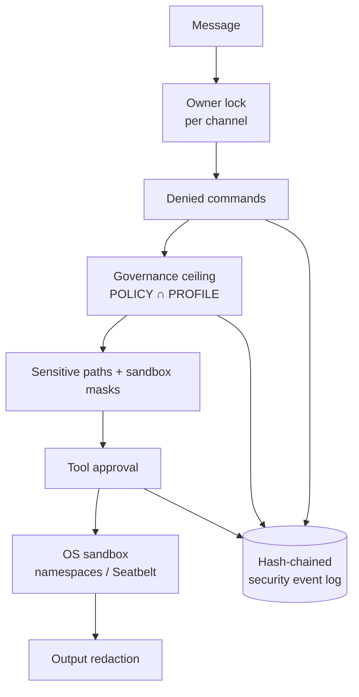

# Lab 58 · Govern Kiro Crew for a team — sandbox, denied commands, policy ceiling and audit

> **Outcome:** A Crew configuration a security reviewer can sign off: what the agent can never do, who may talk to it, which tools a session may use, where credentials live, and evidence that every tool call was checked.

## Scenario

One engineer's Crew is a productivity tool. Twenty engineers' Crews on shared hosts, wired to Slack and AWS, are a platform. Before that happens you want controls the **agent itself cannot weaken**.



## How it works

| Control | Setting / file | Default |
| --- | --- | --- |
| OS sandbox | `agent.sandbox` = `auto` \| `strict` \| `off` | `auto` hides `.gnupg`, `.gcloud`, `.azure`, `.docker`; `strict` also hides `.aws`, `.ssh`, `.kube` |
| Fail-closed | Crew refuses to start the agent unsandboxed unless `agent.sandbox` is `off` or `agent.sandbox_allow_unsandboxed_exec` is `true` | Fail-closed |
| Read-only folders | `agent.sandbox_readonly_paths`, `agent.sandbox_readonly_exceptions` (0.13.0+) | `[]` |
| Denied commands | **Settings → Security → Denied Commands**. Examples: `rm -rf ~`, `git push` to main, `cat ~/.aws/credentials`, `curl 169.254.169.254`, `cdk destroy`, `DROP TABLE` | On; "never bypassed — even in Autopilot mode" |
| Owner lock | Slack `KIROCREW_OWNER_ID`; Discord allowlist; Telegram numeric IDs; Teams Azure AD IDs; WeChat denies all by default | Unauthorized messages are dropped and logged |
| Secrets vault | **Settings → Secrets**; MCP `env` can use `secret://NAME` | A missing secret fails the spawn |
| Governance | `~/.kiro/crew/security_policy.json` (POLICY) + `~/.kiro/crew/profiles/` (PROFILE); effective = POLICY ∩ PROFILE | The agent can neither read nor write these files |
| Audit | `~/.kiro/crew/security_events.jsonl`, HMAC-chained | On |

> **Harness caveat** (Crew security docs): with the Claude Code harness, tools pre-approved in that harness bypass Crew's approval flow and deny rules. Standardize on the Kiro harness for governed hosts.

## Step 1 — Tighten the sandbox

```bash
kirocrew config get agent.sandbox
kirocrew config set agent.sandbox strict     # or keep auto if agents need the aws CLI / git over SSH
```

`strict` hides `~/.aws` and `~/.ssh` (only `~/.ssh/known_hosts` stays readable). If agents need AWS, give the host a narrowly scoped role instead of long-lived keys.

## Step 2 — Review denied commands and approvals

Open **Settings → Security → Denied Commands**, read the built-ins and add your own (for example `terraform destroy`, `kubectl delete ns`). Keep tool approval at **Automatic** or **Interactive** and use **Autopilot** sparingly.

## Step 3 — Lock the channels and move secrets to the vault

Set the owner for every channel you enable. Move tokens out of `.env` into **Settings → Secrets** and reference them from MCP config as `"API_TOKEN": "secret://EXAMPLE_API_TOKEN"`.

## Step 4 — Write and validate a policy ceiling

[`policy/security_policy.example.json`](policy/security_policy.example.json) is the publish-scope example from Crew's governance spec: artifacts may be published only to `deploy-web-aws`, in `us-east-1`, to one AWS account. Adapt it, place it at `~/.kiro/crew/security_policy.json` **from a terminal outside the agent**, then:

```bash
kirocrew policy validate
kirocrew policy show
kirocrew policy explain      # why a given action would be allowed or denied
```

Publish is an authorization decision, so it **fails closed** if evaluation errors.

## Step 5 — Distribute the policy to every host

Host the policy at an internal HTTPS URL and point each host at it with `KIROCREW_POLICY_URL` (config management sets one variable), or put a `distribution` block in a bootstrap policy (`source`, `refresh_interval_secs`, `max_cache_age_secs`, `on_unavailable: "fail_closed"`). Profiles can only **narrow** the ceiling and cannot redirect where it is fetched from.

## Step 6 — Enterprise MCP governance

If `kiro-cli` is signed in with IAM Identity Center and your admin configured an **MCP registry**, `kiro-cli` silently drops non-registry MCP entries when it assembles a session. Symptom: `kirocrew doctor` says MCP servers are healthy, but `spawn_run`, `cron_add` or the knowledge tools are missing in chat. Follow Crew's enterprise MCP governance guide to add Crew's servers to the registry.

## Step 7 — Prove it

```bash
kirocrew security verify     # verify the HMAC chain of the audit log
kirocrew security events     # recent decisions
kirocrew security audit
```

Then try a denied command in chat (for example *"cat ~/.aws/credentials"*) and find the refusal in the events.

## Step 8 — Export metrics *(optional)*

Metrics go to a local JSONL sink by default. To send them to an OpenTelemetry Collector (and on to Amazon CloudWatch), set `telemetry.otlp_endpoint` **and** turn collection on explicitly in `config.json`. Collection and egress are deliberately separate switches. To opt out: `kirocrew telemetry disable` or `DO_NOT_TRACK=1`.

## Verify

- [ ] `kirocrew config get agent.sandbox` shows your chosen tier
- [ ] A denied command was refused with no override card, and logged
- [ ] `kirocrew policy validate` passes and `policy explain` matches your intent
- [ ] `kirocrew security verify` reports an intact chain
- [ ] No channel token or API key remains in `~/.kiro/crew/.env`

## Clean up

Nothing bills. Keep the policy; it's the point.

## Learn more

- [Crew security](https://kiro.dev/docs/crew/security/) · [Configuration](https://kiro.dev/docs/crew/configuration/) · [Governance spec](https://github.com/kirodotdev/KiroCrew/blob/main/docs/system-specs/modules/governance.md) · [Enterprise MCP governance](https://github.com/kirodotdev/KiroCrew/blob/main/docs/guides/enterprise-mcp-governance.md) · [OTLP export](https://github.com/kirodotdev/KiroCrew/blob/main/docs/guides/telemetry-otlp-export.md)
- How the gate works: [Kiro Crew under the hood](../../docs/kiro-crew-internals.md)
- Next: [Lab 59 — Bring your own harness and models](../59-crew-multi-harness-models/README.md)
