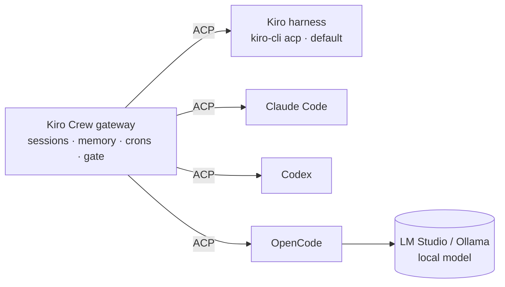

# Lab 59 · Kiro Crew with any agent harness — Kiro, Claude Code, Codex, OpenCode and local models

> **Outcome:** One Crew gateway where new chats can run on the Kiro harness or on another ACP agent, including a fully local model through OpenCode and LM Studio, with a clear map of what changes when you switch.

## Scenario

Kiro Crew is a gateway, not a model: it "drives every LLM through one seam" over the **Agent Client Protocol**. The harness behind a session is a setting. That lets a team keep one workspace (memory, schedules, apps, governance) while choosing the runtime per need: Kiro for the default, another vendor's agent where a team already pays for it, or a local model for air-gapped or offline work.



## How it works

| Setting | Meaning |
| --- | --- |
| `agent.provider` | Always `acp` |
| `agent.acp_backend` | The harness for **new** sessions (for example `kas`, `claude`, `codex`, `opencode`, `pi`, `goose`). An existing chat keeps the harness it started on |
| `agent.member_acp_backend` | Harness for Bot DM threads. Unset: Bots follow `acp_backend`, but only onto a harness that can carry a Bot's workers (OpenCode and goose can't, so Bots stay on Kiro) |
| **Settings → Agent Harness** | Pick the harness; shows missing binaries and the install command |

What to watch when you switch:

- **Models and credentials** belong to the harness. Crew holds no LM Studio, OpenRouter or Ollama key.
- **Governance gap:** with the Claude Code harness, tools pre-approved *inside Claude Code* bypass Crew's approval flow and deny rules. Keep governed hosts on the Kiro harness (see [Lab 58](../58-crew-governance-for-teams/README.md)).
- **Feature parity** differs by harness; Crew's provider spec has the capability matrix.

## Step 1 — See what you're on

```bash
kirocrew doctor            # selected harness and sign-in state
kirocrew config get agent.acp_backend
```

## Step 2 — Switch to another vendor's agent (optional)

If you already use Claude Code or Codex, sign in to it on the gateway host, then choose it in **Settings → Agent Harness**. Open a new chat and run the same prompt you used on Kiro; compare tool calls and results in the Activity view.

## Step 3 — A fully local model through OpenCode

1. Install OpenCode 1 (the line Crew tests against): `npm i -g opencode-ai@1`.
2. Start LM Studio's server, load a model that supports tool use, and check it: `curl http://localhost:1234/v1/models`.
3. Merge [`config/opencode.lmstudio.json`](config/opencode.lmstudio.json) into `~/.config/opencode/opencode.json` (change the model id to yours), then confirm: `opencode models lmstudio`.
4. Select OpenCode in **Settings → Agent Harness**, or merge [`config/crew-agent-backend.json`](config/crew-agent-backend.json) into `~/.kiro/crew/config.json`.
5. Start a **new** chat, pick the local model, and ask for something tool-heavy, such as *"List the five largest files in this repo and explain what each is."*

## Step 4 — Switch back

Set the harness back to Kiro in **Settings → Agent Harness**. Your memory, crons and apps were never tied to the harness.

## Verify

- [ ] New chats show the selected harness; old chats kept theirs
- [ ] The local-model chat called tools and answered without network access to a model provider
- [ ] Denied commands were still refused on every harness you tried (and you noted the Claude Code caveat)

## Clean up

Stop LM Studio's server. Remove the `lmstudio` provider from `opencode.json` if you don't need it.

## Learn more

- [Agent backends](https://kiro.dev/docs/crew/features/agent-backends/) · [Local and hosted models guide](https://github.com/kirodotdev/KiroCrew/blob/main/docs/guides/local-and-hosted-models.md) · [Provider spec](https://github.com/kirodotdev/KiroCrew/blob/main/docs/system-specs/modules/providers.md) · [Agent Client Protocol](https://agentclientprotocol.com)
- ACP from your editor: [Lab 11](../11-acp-editor-integration/README.md)
- Next: [Lab 60 — Knowledge, research campaigns and memory](../60-crew-knowledge-research-memory/README.md)
