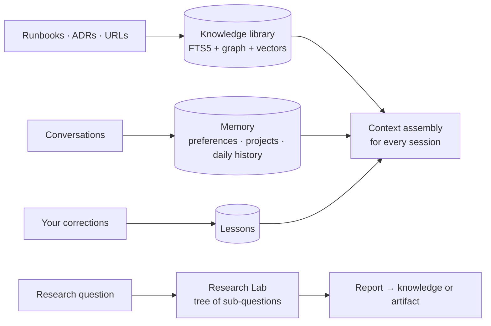

# Lab 60 · Kiro Crew knowledge, research campaigns and memory

> **Outcome:** A Crew that answers from your runbooks with citations, remembers how your team likes things done, runs an unattended research campaign into a shareable report, and can be backed up and restored with one command.

## Scenario

A new teammate asks the same five questions every new teammate asks. The answers are in runbooks, ADRs and old Slack threads. Crew keeps three kinds of memory locally, and knowing which is which is what makes it useful instead of creepy.



## How it works

| Store | What goes in | How it's used | Inspect with |
| --- | --- | --- | --- |
| **Knowledge library** | Folders, uploads, artifacts, fetched URLs; chunked and entity-extracted | Hybrid retrieval (FTS5 + graph + vector) through the `local_knowledge_search` tool and the dashboard Knowledge tab | `kirocrew knowledge stats` |
| **Memory** | Consolidated from conversations: preferences, projects, daily history | Injected into new sessions on the same store, decaying with age | `kirocrew memory show`, `memory search`, `memory stats` |
| **Lessons** | Corrections ("No, always run the frontend checks…") | Injected into later sessions | `kirocrew learn list` |

Embeddings run **in-process**: a ~610 MB model downloads on first start, and keyword search is used until it lands. Nothing is sent to an embedding service.

## Step 1 — Ingest your runbooks

In the dashboard **Knowledge** tab, add a folder of markdown runbooks (or a few internal URLs). Or ask in chat: *"Add the docs/runbooks folder to my knowledge library."* Then check:

```bash
kirocrew knowledge stats
kirocrew knowledge dedup          # dry run: shows cross-source duplicates, writes nothing
```

Ask a question that needs two documents: *"How do we rotate the payments API key, and who approves it?"* Expect citations.

## Step 2 — Teach a lesson

Correct it once in chat: *"No — in this repo always run `npm run lint` before tests."* Then:

```bash
kirocrew learn list
kirocrew learn add "Use pnpm, not npm, in the web/ workspace"
```

Open a new chat in the same project and ask it to run the checks. It should follow both lessons.

## Step 3 — Inspect and audit memory

```bash
kirocrew memory show preferences
kirocrew memory search "deploy" --layer all
kirocrew memory audit             # scans stores for suspicious content (e.g. injected instructions)
```

Use **incognito** or **temporary** memory mode for sensitive chats; restricted sessions don't write memory or keep transcripts.

## Step 4 — Run a research campaign

Enable **Apps → Discover → Research Lab**. Ask a question that needs digging, for example: *"Which of our three queueing options (SQS, EventBridge Pipes, Kinesis) fits the order-events workload, given our runbooks and AWS docs?"* It expands the question into a tree of sub-questions, sends agents to each, streams findings and stops when the question is answered or progress stalls. Hand the report to the knowledge library or save it as an artifact.

## Step 5 — Snapshot and restore

```bash
kirocrew snapshot --keep 7          # .tar.gz of Crew state into the snapshots folder
kirocrew snapshot --list
kirocrew restore <file> --dry-run   # preview; then --mode merge or replace
```

Snapshots default to `--purpose backup` and can contain credentials. Store them like secrets. The audit-chain key (`sel_hmac.key`) is excluded by design.

## Verify

- [ ] A two-document question was answered with citations from your runbooks
- [ ] Both lessons applied in a fresh chat
- [ ] `kirocrew memory audit` ran clean (or you understood each finding)
- [ ] A research report was saved to knowledge or as an artifact
- [ ] `restore --dry-run` listed the components it would restore

## Clean up

Remove test lessons with `kirocrew learn remove <substring>`. Delete snapshots you don't need.

## Learn more

- [Memory](https://kiro.dev/docs/crew/features/memory/) · [Knowledge](https://kiro.dev/docs/crew/features/knowledge/) · [Snapshot & restore](https://kiro.dev/docs/crew/features/snapshot/) · [Knowledge spec](https://github.com/kirodotdev/KiroCrew/blob/main/docs/system-specs/modules/knowledge.md)
- Kiro CLI's own memory: [Lab 40](../40-kiro-cli-persistent-memory/README.md)
- Next: [Lab 61 — Capstone: an AI-first team on Kiro Crew](../61-e2e-ai-first-team-on-crew/README.md)
