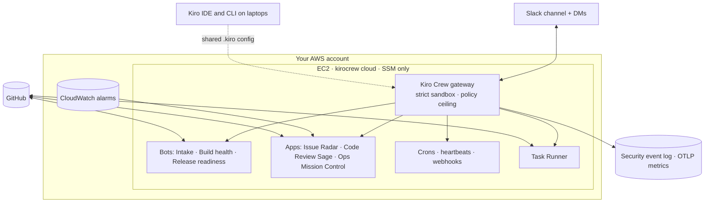

# Lab 61 · Capstone — an AI-first engineering team on Kiro Crew

> **Outcome:** By the end of the day your team talks to one Crew in Slack. Bots own triage, CI health and release readiness. Alarms are claimed and investigated before a human looks. Every action is governed, audited and measured.

## Scenario

A six-person team runs a SaaS product on AWS. They already use Kiro IDE and CLI for interactive work ([how they relate](../../docs/kiro-ide-cli-internals.md)). The gaps are the hours between sessions: overnight alarms, PRs waiting for review, flaky CI on Monday morning, and the release checklist nobody owns. This capstone combines Labs 51–60 into one operating model.

## Phase 1 — Foundation (1 h)

1. Launch the team gateway on EC2 with no inbound ports: [Lab 57](../57-crew-24x7-on-aws/README.md), Option C.
2. Apply governance before anyone connects: strict sandbox, denied commands, policy ceiling, secrets vault: [Lab 58](../58-crew-governance-for-teams/README.md).
3. Give the instance role read-only GitHub (via `gh` with a fine-grained token stored in the vault) and read-only CloudWatch.

## Phase 2 — Front door (45 min)

1. Connect Slack (Socket Mode, no public URL) with the dashboard's **Settings → Messaging Channels → Slack → Setup wizard**.
2. Set the owner lock. For a team, decide who may talk to the bot and document it.
3. Check: a DM to the bot gets a reply; a message from a non-owner is dropped and logged.

## Phase 3 — Bots that own recurring work (1.5 h)

Turn on **Settings → Developer → Feature Previews → Crewmates** (Crew 0.10.0+). Create three bots from the charters in [Lab 13](../13-kiro-crew-bots/README.md): **Intake**, **Build health**, **Release readiness**. Each has its own thread, memory and workspace. Start them comment-only; bots propose setting changes as cards you accept.

## Phase 4 — Schedules and watches (45 min)

From [Lab 51](../51-crew-scheduling-heartbeats-webhooks/README.md):

- `morning-briefing` agent cron at 08:45 to the team channel (`--timezone` set).
- `ci-watch` script job every 15 min: no model call unless main is red.
- A webhook your deploy pipeline calls after staging deploys ("smoke-test checkout and report").

## Phase 5 — Apps in the dev loop (1.5 h)

From [Lab 55](../55-crew-engineering-apps/README.md) and [Lab 56](../56-crew-ops-mission-control/README.md):

- **Issue Radar** for the morning triage, with findings in its ledger.
- **Code Review Sage** on every PR, publishing **draft** reviews only.
- **Ops Mission Control** on CloudWatch in `observe`. Move to `propose` after a week, and to `act` only for allowlisted, bounded silences.

## Phase 6 — Long-running work (1 h)

Give the Task Runner one real, well-specified backlog item ([Lab 52](../52-crew-task-runner-overnight/README.md)) with force approval on anything that publishes. Review its branch like a contributor's PR the next morning.

## Phase 7 — Package and measure (1 h)

1. Package the team's digest agent, skill and schedule as an app ([Lab 54](../54-crew-build-your-first-app/README.md)) so a second team can install it.
2. Export metrics over OTLP to CloudWatch and track, weekly:

| Metric | Source | Target after 4 weeks |
| --- | --- | --- |
| Median time from alarm to first diagnosis | Ops Mission Control board | Under 10 min |
| PRs waiting > 24 h for first review | GitHub | Halved |
| Issues untriaged > 48 h | Issue Radar | Zero |
| Bot proposals accepted / rejected | Bot threads | Rising acceptance |
| Denied-command and policy refusals | `kirocrew security events` | Reviewed weekly; each has an owner |
| Kiro credits per week | Crew usage panel | Within budget |

## Guardrails

- Nothing merges, deploys or deletes without a human: force approval, draft reviews, `observe`/`propose` first.
- Keep governed hosts on the Kiro harness ([Lab 59](../59-crew-multi-harness-models/README.md) explains why).
- Snapshot weekly and store snapshots like secrets ([Lab 60](../60-crew-knowledge-research-memory/README.md)).
- Re-read your bot charters monthly and retire bots that don't earn their keep.

## Verify

- [ ] The team reaches Crew only through Slack and the SSM tunnel; the instance has no inbound rules
- [ ] Each bot has a written charter, a stop condition and a measured outcome
- [ ] `kirocrew security verify` passes and refusals are reviewed
- [ ] One week of the metrics table is filled in

## Clean up

`kirocrew cloud destroy` removes the stack. Delete test alarms, webhooks tokens and draft PRs.

## Learn more

- [Kiro Crew docs](https://kiro.dev/docs/crew/) · [Bots](https://kiro.dev/docs/crew/bots/) · [kirodotdev/KiroCrew](https://github.com/kirodotdev/KiroCrew)
- [Kiro Crew under the hood](../../docs/kiro-crew-internals.md) · [Introducing Kiro Crew](https://kiro.dev/blog/introducing-kiro-crew/)
