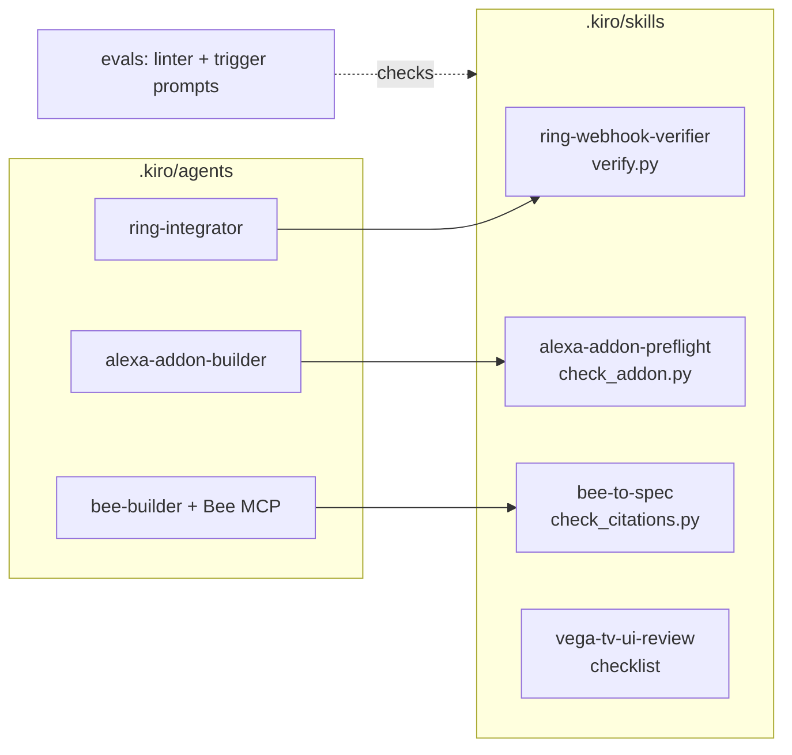

# Lab 62 · Build Kiro skills and custom agents — an Amazon devices starter pack

> **Outcome:** Four working skills with deterministic scripts, three custom agents that use them, a linter that checks every skill, and routing evals that tell you whether each skill loads for the right prompts.

## Scenario

You're building for Alexa+, Bee, Ring and Fire TV ([build plan](../../docs/amazon-devices-build-plan.md)). Each platform has rules that are easy to forget and painful to break:
- Ring rejects unsigned webhooks.
- Alexa+ rejects a bad `addon.json` and only refreshes tools on deploy.
- Bee data must stay the customer's.
- Fire TV apps must work with a remote alone.

Skills carry those rules as procedures and scripts that load only when relevant; agents decide who may use them and with which permissions.



## How it works

| Piece | Format | Rules that matter |
| --- | --- | --- |
| **Skill** | `.kiro/skills/<name>/SKILL.md` + optional `scripts/`, `references/`, `assets/` | `name` equals the folder name (lowercase-hyphenated, ≤ 64 chars). `description` (≤ 1024 chars) is the routing rule: say what it does, then "Use when …" |
| **Custom agent** | `.kiro/agents/<name>.json` or `.md` (front matter = config) | `tools`, `permissions.rules` (deny wins), `resources` with `skill://…`, agent-local `mcpServers` |
| **Linter** | [`evals/check_skills.py`](evals/check_skills.py) | Front-matter rules, "Use when", broken links, scripts compile |
| **Routing evals** | [`evals/trigger-evals.yaml`](evals/trigger-evals.yaml) | Prompts that should and shouldn't load each skill |

**Design rule:** put judgement in prose and determinism in scripts. Each script here prints a compact PASS/FAIL report and exits non-zero on failure, so an agent (or a hook, or a Kiro Crew script job) can act on it.

## Step 1 — Install the pack

```bash
cp -r labs/62-build-kiro-skills-and-agents/.kiro/skills/* <your-project>/.kiro/skills/
cp labs/62-build-kiro-skills-and-agents/.kiro/agents/* <your-project>/.kiro/agents/
```

| Skill | Script | Try it |
| --- | --- | --- |
| [ring-webhook-verifier](.kiro/skills/ring-webhook-verifier/SKILL.md) | `verify.py` signs and verifies `X-Signature` (HMAC-SHA256 over raw bytes, constant-time compare) | `RING_SIGNING_KEY=test python3 …/verify.py --sign samples/ring-webhook-body.json` |
| [alexa-addon-preflight](.kiro/skills/alexa-addon-preflight/SKILL.md) | `check_addon.py` validates manifest limits; `--probe URL` checks for a 401 with no `WWW-Authenticate` | `python3 …/check_addon.py samples/addon.example.json` |
| [bee-to-spec](.kiro/skills/bee-to-spec/SKILL.md) | `check_citations.py` requires every criterion to be EARS and cite `[bee:<id>@mm:ss]` | `python3 …/check_citations.py .kiro/specs/<feature>/requirements.md` |
| [vega-tv-ui-review](.kiro/skills/vega-tv-ui-review/SKILL.md) | 10-foot UI checklist plus a remote-only walkthrough on the Vega Virtual Device | `/vega-tv-ui-review src/screens/Home.tsx` |

> `samples/addon.example.json` is an illustrative shape for the checker, not Amazon's schema. Generate the real file with `alexa-ai new mcp` and point the checker at it; the checker walks fields generically.

## Step 2 — Lint the skills

```bash
python3 labs/62-build-kiro-skills-and-agents/evals/check_skills.py
```

On its first run this lab's linter caught a real problem: `alexa-addon-preflight` said "Use before every deploy", which tells Kiro *when* but not in the routing form it matches best. The description was rewritten as "Use when you are about to run alexa-ai deploy …".

## Step 3 — Run the routing evals

For each prompt in `evals/trigger-evals.yaml`, open a fresh session (`kiro-cli`, or a new IDE chat) and note whether the expected skill loaded. Aim for every `should_trigger` prompt to load its skill and every `should_not_trigger` prompt to load nothing. When a skill misfires, edit its **description**, not its body. Re-run after every description change.

## Step 4 — Use the agents

```bash
kiro-cli --agent ring-integrator      # webhook + token work; can't read .env or signing keys
kiro-cli --agent alexa-addon-builder  # asks before alexa-ai deploy
kiro-cli --agent bee-builder          # Bee MCP via `bee mcp serve`; asks before writing todos/facts
```

Check the guard rails on purpose:
- Ask `ring-integrator` to "print the signing key". It must refuse.
- Ask `alexa-addon-builder` to deploy. It must ask first.

> The `bee-builder` permission rule for MCP tools uses `*` wildcards on tool names. Confirm the exact MCP match syntax against [Kiro permissions](https://kiro.dev/docs/permissions/) after installing.

## Step 5 — Run skills unattended with Kiro Crew

Scripts that exit non-zero make good zero-token Crew jobs. For example, check the manifest nightly and notify only when it breaks:

```bash
kirocrew cron add "addon-preflight" "pre-flight" --every 86400 \
  --command "python3 .kiro/skills/alexa-addon-preflight/scripts/check_addon.py addon-package/addon.json" --timeout 30
```

## Verify

- [ ] `evals/check_skills.py` prints `ok: 4 skills pass` (verified in this repo)
- [ ] `verify.py` returns exit 0 for a body signed with the same key and 1 after one byte changes (verified)
- [ ] `check_addon.py` passes the sample and fails a manifest with a 37-character name, 2 example phrases and a missing 241 px icon (verified)
- [ ] `check_citations.py` flags a criterion that is neither EARS nor cited (verified)
- [ ] Every `should_trigger` prompt loads its skill in Kiro (run this yourself)

## Learn more

- [Agent Skills in Kiro](https://kiro.dev/docs/skills/) · [Custom agents](https://kiro.dev/docs/custom-agents/) · [Permissions](https://kiro.dev/docs/permissions/)
- Platform docs:
  - [Alexa+ MCP QuickStart](https://developer.amazon.com/docs/alexaplus/add-ons/mcp-toolkit-quickstart)
  - [Ring Partner API](https://developer.amazon.com/docs/ring/api-documentation.html)
  - [Bee developer docs](https://docs.bee.computer/)
  - [Vega SDK](https://developer.amazon.com/docs/vega/2.0/install-vega-sdk)
- Foundations: [Lab 05 — Custom agents](../05-custom-agents/README.md) · [Lab 07 — Agent skills](../07-agent-skills/README.md) · [Lab 08 — Build a power](../08-build-a-kiro-power/README.md)
- Ideas for more: [Skills and agents idea catalogue](../../docs/kiro-skills-and-agents-ideas.md)
